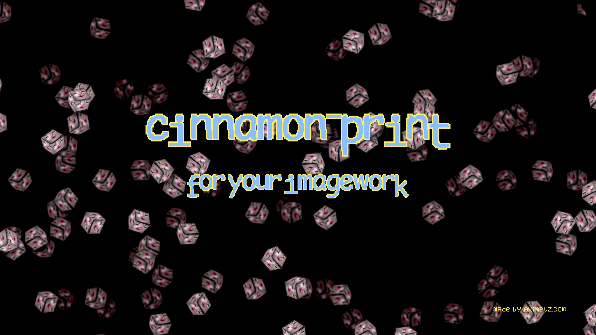
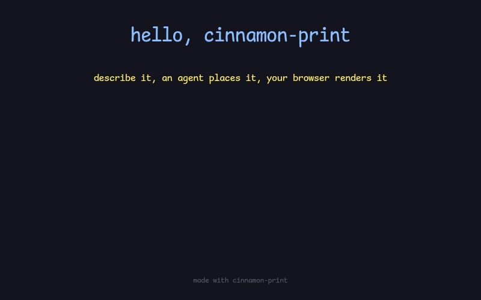

<p align="center">
  
</p>

# cinnamon-print

**describe it, an agent places it, chromium renders it — reproducibly.**

a docker-in-a-folder composition package: give it fragment images, text, fonts and procedural shaders, get a finished png or pdf. built for flyers, cover art, zines and social cards.

[project page](https://akinevz.com/projects/cinnamon-print)

## what it makes

you describe a layout (`project/<stem>/layout.json` — one folder per
project in the store; the full starter is `project/layout.example.json`):

```json
{
  "canvas": { "width": 800, "height": 500, "background": "#14141e" },
  "fonts": [{ "file": "ComicMono.ttf", "name": "ComicMono" }],
  "elements": [
    { "type": "text", "text": "hello, cinnamon-print",
      "x": 40, "y": 40, "width": 720, "align": "center",
      "font": "ComicMono", "size": 32, "color": "#8cbfff" },
    { "type": "text", "text": "describe it, an agent places it, your browser renders it",
      "x": 40, "y": 120, "width": 720, "align": "center",
      "font": "ComicMono", "size": 16, "color": "#feef69" }
  ]
}
```

…and get this (one `make png`; hand the geometry to the pipeline — pinned
elements like the footer sit outside the flow and survive any later arrange):

<p align="center">
  
</p>

## try it

```sh
git clone https://github.com/akinevz2/cinnamon-print
cd cinnamon-print
./run.sh build
make png FILE=demo-example   # -> project/demo-example/output/demo-example.png
make pdf FILE=demo-example   # -> project/demo-example/output/demo-example.pdf
make repl                    # agent-assisted session in the container
```

the only prerequisite is [docker](https://docs.docker.com/get-docker/). everything else
(pandoc, node, chromium, fonts, opencode) is built with nix inside the container.

**windows**: run `requirements.bat` once (installs GNU Make + Docker Desktop via
winget), then `run.bat` — it starts the docker engine if needed, builds the image
on first run, launches the repl session, and tears the container down on exit.

## how it works

1. **describe it.** each project is a folder in the store: `project/<stem>/layout.json` is its single source of truth: canvas, `fragment*.png` placements, text, fonts.
2. **an agent places it.** in `make repl`, the opencode agent scans your fragments, lints the layout for overlaps and overflow, and proposes placements with you.
3. **it renders.** a compose script generates html, applies a pandoc template, and renders png and pdf through headless chromium from the same layout.
4. **it's a live loop.** the repl rebuilds the latest artifact on start, tracks your edits, and reports per-project build progress — every render (single-pass or iterative) shows up on the console automatically.
5. **reproducibly.** same folder, same docker, same result.

## the project console

`make repl` and `make serve` print a friendly URL — `localhost:8899`. open it and:

- **`/`** — the project console (redirects to `/cloud`): live build-stage preview, per-project progress bars (a single render shows 1/1; iterative agent renders adaptively show N/(N+1) "in progress" until closed), and the project sidebar auto-opened on the **latest worked-on** artifact
- **fragment library** — the right-hand pane: every `.frag` in `resources/shaders/` rendered live; drag keepers straight into `resources/fragments/`
- **🗑 trash** — projects and frags delete with a confirmation; files move restorably to gitignored `.opencode/trash/`
- **`/compose.html`** — the bare composed-artifact preview of the active project (what livereload refreshes)
- **`/frag`** — the standalone frag bench

## status

| works today | still being sanded |
| :--- | :--- |
| single-shot png and pdf (`make png` / `make pdf`) | frag bench drag-to-compose flow |
| layout lint (`make check-layout`), auto-stacking (`make arrange`), pinned elements | linux agent REPL: needs a real tty, first-run auth inside the tui |
| livereload preview on `localhost:8899` (`make serve`) | windows path (`requirements.bat` + `run.bat`) is new — untested in the wild |
| persistent repl sessions: config + auth + history survive restarts (`.opencode/cache/`, gitignored) | |
| per-project build progress: auto-adaptive (single renders = 1/1, iterative re-renders = N/(N+1) until closed) | |
| project console: latest-worked-on auto-open, restorable trash for projects and frags | |
| frag bench: live shader synthesis, headless shader/font rasterization (container-native), monte-carlo cloud fill | |
| test suite: `npm run test` (layout lint/arrange/pin contract, node --test) | |

## frag bench: shaders without a gpu in the container

your browser doubles as a WebGL worker. the agent writes GLSL into `resources/shaders/`,
the frag bench tab compiles each `.frag` live into a high-resolution swatch, and you drag the
keepers into `resources/fragments/` as `fragment*.png`. from there the normal lint-and-compose
pipeline takes over. conventions live in `resources/shaders/SHADER-NOTES.md`.

tooling split: `scripts/frag-render.sh` (shader → transparent png) and
`scripts/font-to-glsl.sh` (ttf → bitmap glyph rows) are **container-native** —
node + chromium, nothing else. the richer magick/python variants
(`font-to-glsl.py`, `gen-banner-frag.py`) are host-only; `cloud-step.sh`
drives monte-carlo fills with per-step progress and soft silhouette shadows.

<details>
<summary>project layout</summary>

```text
cinnamon-print/
  Makefile                  # entry point for everything (bare `make` = interactive session)
  AGENTS.md                 # always-in-context agent rules (skill-first, shipped machinery only)
  Dockerfile                # docker build, environment from nix (flake.nix)
  flake.nix                 # the nix "buildfile": packages for the container
  requirements.bat          # windows: winget-installs GNU Make + Docker Desktop
  run.sh                    # unix helper (build / repl / serve / png / pdf)
  run.bat                   # windows: engine autostart -> make repl (docker fallback) -> teardown
  cinnamon-print_banner.png # the hero banner — rendered by the pipeline itself
  scripts/
    compose.mjs             # single-shot artifact rebuild (layout -> html -> png/pdf)
                            #   + auto-adaptive per-project progress
    serve.mjs               # livereload webserver + project console / frag bench / trash APIs
    layout.mjs              # text-geometry lint + auto-arrange (honors "pinned": true)
    repl-session.sh         # in-container session orchestration (rebuild -> serve -> opencode -> teardown)
    progress.sh             # per-project build-progress primitive (<stem>.progress state)
    cloud-step.sh           # one monte-carlo cloud-fill step (progress via progress.sh)
    pngio.mjs               # zero-dep 8-bit RGBA PNG decode/encode (node zlib)
    trace-cutout.mjs        # trace a character out of a scene -> cutout + background fragments
    meta.mjs                # per-output title/prompt metadata sidecars
    frag-render.sh          # .frag -> transparent png (headless chromium, container-native)
    font-to-glsl.sh         # ttf -> GLSL bitmap glyph rows (chromium-based, container-native)
    font-to-glsl.py         # ttf -> glyph rows (magick-based, host-only)
    gen-banner-frag.py      # full text-banner .frag generator (host-only)
    font-bits.html          # chromium page behind font-to-glsl.sh
    frag-headless.html      # chromium page behind frag-render.sh
    frag-scan.js            # client-side WebGL renderer for live .frag shaders
  tests/
    layout.test.mjs         # node --test suite: lint/arrange/pin contract
  project/                  # CODE + composition machinery
    templates/
      compose.html.tmpl     # pandoc template (agent-maintained, png AND pdf)
    <stem>/                 # ONE FOLDER PER PROJECT (1:1) — the store
      layout.json           #   the project's composition (canvas + placement)
      project.json          #   optional metadata: title / prompt
      output/               #   rendered artifacts + <stem>.progress state
    cinnamon-print/         # the app's own artifacts when needful
    templates/
      compose.html.tmpl     # pandoc template (agent-maintained, png AND pdf)
    layout.example.json     # starter layout — copy into a new project folder
    cloud.html              # project console page (/, /cloud)
    frag.html               # /frag — standalone frag bench page
  resources/                # DATA — your media, kept separate from code
    fragments/              # your fragment*.png components go here
    shaders/                # agent-authored .frag shaders, watched live by the bench
    fonts/                  # custom .ttf/.otf fonts go here
    ship-crew.trace.json    # worked-example trace hints for trace-cutout.mjs
    banner.png              # hero render, referenced by the README
  .opencode/
    skill/cinnamon-print/   # skill loaded in interactive sessions (mounted in)
    cache/                  # gitignored: repl config + state (auth, sessions, history)
    trash/                  # gitignored: trashed projects/frag files (restorable)
```

</details>
